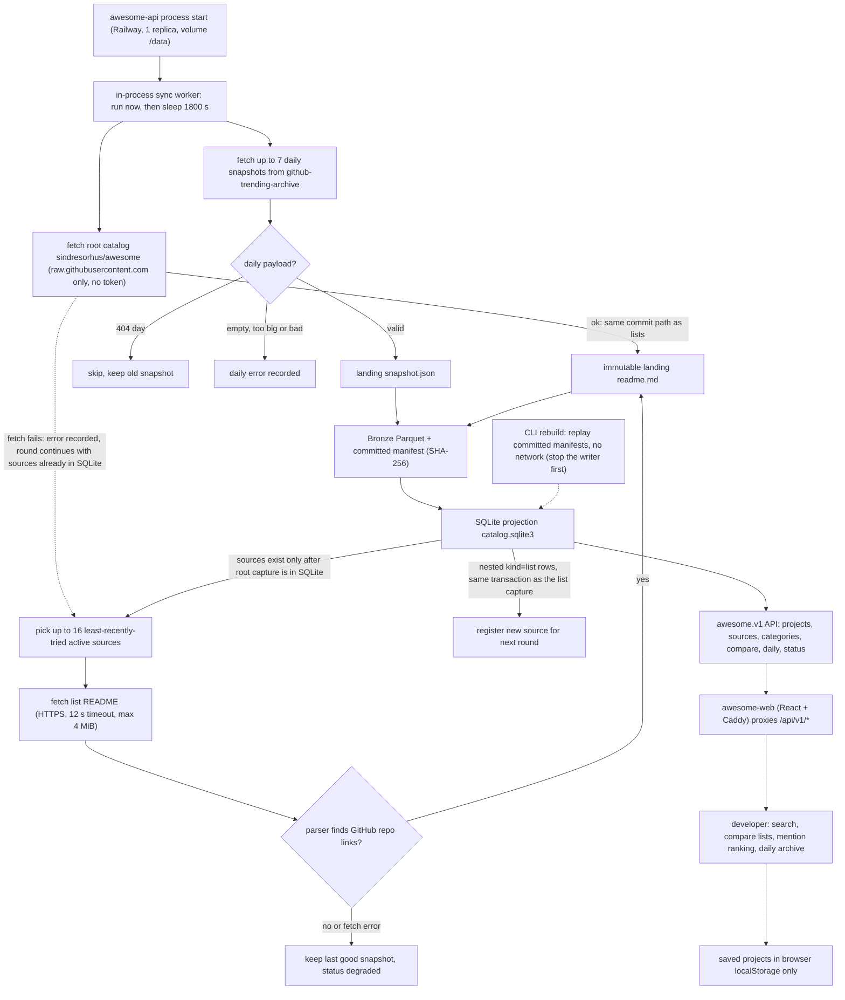
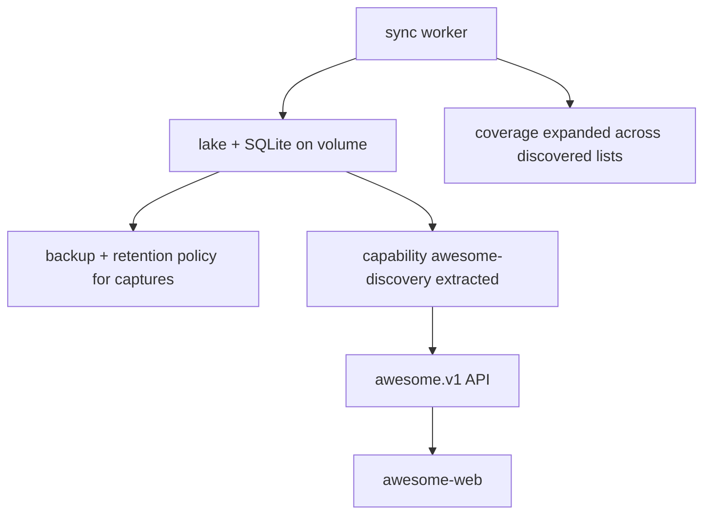

# 01 — Business process (As-Is / To-Be)

Awesome Atlas คือเว็บสาธารณะ (ไม่มี login) ให้นักพัฒนาค้นหา เปรียบเทียบ และจัดอันดับโปรเจกต์จาก GitHub Awesome lists และอ่าน GitHub Trending รายวัน โดย `awesome-api` ซิงก์ README สาธารณะทุก 30 นาทีเข้า lake ของตัวเอง แล้ว `awesome-web` อ่านผ่าน proxy

Last reviewed: 2026-11-28 · commit `4ac71a0`

## As-Is (จากโค้ดวันนี้)

Sources: `services/awesome-api/awesome_api/sync.py`, `services/awesome-api/awesome_api/app.py`, `services/awesome-api/awesome_api/lake.py`, `services/awesome-api/awesome_api/parser.py`, `services/awesome-api/awesome_api/cli.py`, `services/awesome-api/README.md`, `services/awesome-api/deployment/README.md`, `apps/awesome-web/src/App.tsx`, `PRODUCT.md`

ข้อเท็จจริงจากโค้ดและเอกสาร:

- worker อยู่ใน process ของ API ไม่มี scheduler ภายนอก; ต้องคงหนึ่ง replica เพราะไม่มี distributed lock
- ไม่มี managed backup และไม่มี retention อัตโนมัติของ lake บน volume (`services/awesome-api/deployment/README.md`)
- coverage ล่าสุดที่บันทึกไว้คือ 1,481 จาก 1,944 sources, `state: degraded` (`PRODUCT.md`, 2026-10-22) [ต้องยืนยัน] ค่าปัจจุบันบน production

## To-Be (`apps/awesome-web/DOCPACK/01-prd.md` §Roadmap/phase, `services/awesome-api/docs/source-inventory.md` §Risk and action)

Sources: `apps/awesome-web/DOCPACK/01-prd.md` (phase ถัดไป ยังเป็น [ต้องยืนยัน] ในเอกสาร), `services/awesome-api/docs/source-inventory.md`, `services/awesome-api/docs/data-product-charter.md`

## Gap

| ID | As-Is → To-Be | Status | Owner | Evidence |
|---|---|---|---|---|
| G1 | lake/SQLite บน Railway volume ไม่มี managed backup → มี backup ของ capture | todo | owner | `services/awesome-api/docs/source-inventory.md` Risk row "ทุกแหล่ง" (open); `deployment/README.md` §ข้อมูลและการกู้คืน |
| G2 | เก็บทุก committed capture ไม่มีการลบ → กำหนด retention และติดตาม volume usage | todo | claude | `services/awesome-api/docs/data-product-charter.md`; `source-inventory.md` |
| G3 | coverage บางส่วน (state degraded) → ขยาย coverage ลิสต์ โดยยังไม่มีเป้าตัวเลข | decide | owner | `apps/awesome-web/DOCPACK/01-prd.md` §ตัวชี้วัด และ §Roadmap |
| G4 | API อยู่ใน repo นี้ → แยกเป็น capability `awesome-discovery` | decide | owner | `apps/awesome-web/DOCPACK/01-prd.md` Extraction `pending` |
| G5 | worker หนึ่ง process ไม่มี lock → ถ้าจะขยาย replica ต้องแยก worker และเพิ่ม distributed lock | decide | owner | `services/awesome-api/README.md` §การอัปเดต |

## Open questions

- `apps/awesome-web/PRODUCT.md` ยังเขียนว่า "ไม่อ้างว่ามี hosted deployment" ขัดกับ README และ `PRODUCT.md` ที่ root (R-03 ใน PRD)
- จะวัดผู้ใช้หรือไม่ (ไม่มี analytics ในโค้ด) และเปิดสาธารณะหรือเก็บเป็น portfolio (`DOCPACK/00-product-card.md` §8)
- web เป็นส่วนหนึ่งของระบบเดียวกันในไฟล์นี้ ไม่ได้แยก `apps/awesome-web/docs/diagrams/01-business-process.md`
